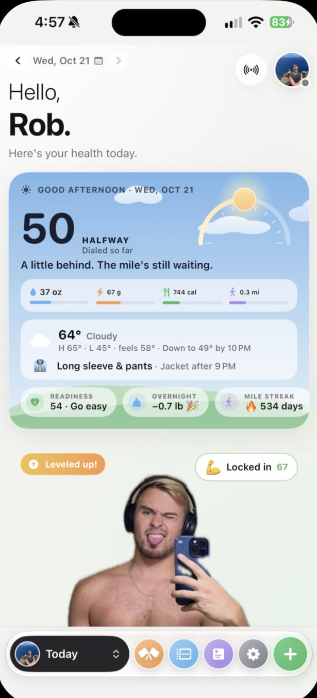
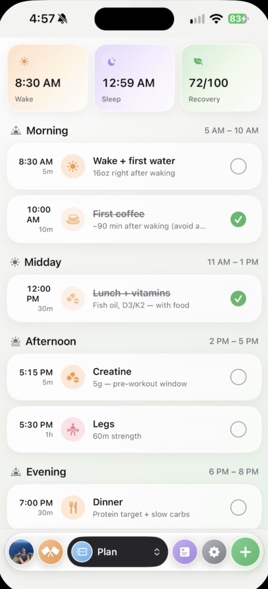

# 📈 Dialed — Personal Fitness OS


An automated daily fitness dashboard that pulls health data from Apple Health (RingConn, Apple Watch, smart water bottles) and outputs a single daily score with streaks and trends.

Open the app and it tells you, in one number, how dialed in you are today, what's left to hit (water, protein, calories, your mile), what to wear for the weather, and how ready your body is to train.

<p align="center">
  
  &nbsp;&nbsp;
  
</p>

## Dialed 3.0 — Home + Weight-Loss Challenge

- **Home (light "Neka" design)**: greeting, your photo with the background removed on-device (Vision) and live vitals pinned to it (heart, breathing, blood O₂, weight), challenge scoreboard, body-state rings, Weight / Water / HRV / Sleep / Resting HR / Activity tiles, Fuel (protein + calorie budget), today's timeline, and a rules-based Coach. Floating quick-log bar for water, weigh-in, meal and voice.
- **Challenge tab**: head-to-head vs. a friend (scored by % of body weight or total lbs), weight vs. goal-pace chart, trend projection to the final day, weekly rate, and the daily deficit needed to hit your goal. Log your friend's weigh-ins by hand.
- **Devices**: Pixel Watch through the Google Health API (the Fitbit Web API shuts down Oct 30, 2026; see `SETUP_GOOGLE_HEALTH.md`), smart scale via Apple Health or Google Health weight, WaterH bottle via the WaterH app writing water to Apple Health. Manual weigh-ins are stored as `WeightEntry`.
- Logic lives in `WeightChallengeEngine` and `CoachEngine` (pure, unit-tested).

## Features (Automation-First Design)

### Fully Automated ✅
- **Sleep Scoring**: Automatically calculated from RingConn data (duration, deep sleep, REM, HRV)
- **Workout Detection**: Auto-detects workouts from Apple Watch
- **Mile Detection**: Automatically tracks running workouts ≥ 1 mile
- **Water Intake**: Syncs from smart water bottle via HealthKit
- **Activity Metrics**: Steps, active energy, exercise minutes

### Quick Manual Inputs ⚡
- Workout quality rating (0-5) for detected workouts
- Mile quality rating (0-5) for detected runs
- Food logging (protein, calories)
- Daily checklist (skincare, supplements)

### Intelligent Scoring
- **0-100 Daily Score** calculated from:
  - Protein adherence (25 pts)
  - Workout completion + quality (20 pts)
  - Mile completion + quality (15 pts)
  - Sleep score (20 pts) - fully automated
  - Hydration (10 pts)
  - Routine checklist (10 pts)

## Architecture

### Tech Stack
- **Platform**: iOS 17+
- **Framework**: SwiftUI
- **Data Layer**: SwiftData (Core Data replacement)
- **Integration**: HealthKit
- **Testing**: XCTest

### Project Structure

```
Dialed/
├── App/
│   ├── DialedApp.swift          # App entry point
│   ├── AppState.swift            # Global app state
│   └── ContentView.swift         # Main navigation
├── Models/
│   ├── UserSettings.swift        # User preferences (UserDefaults)
│   ├── DayLog.swift              # Main daily log (@Model)
│   ├── ChecklistItem.swift       # Checklist tasks (@Model)
│   ├── FoodEntry.swift           # Food logging (@Model)
│   └── WorkoutLog.swift          # Workout details (@Model)
├── Services/
│   ├── ScoringEngine.swift       # Pure scoring logic (testable)
│   ├── HealthKitManager.swift    # HealthKit data fetching
│   └── HealthDataSyncService.swift # Sync HealthKit → DayLog
├── Views/
│   ├── Today/                    # Main dashboard
│   ├── Log/                      # Food & workout logging
│   ├── Calendar/                 # Score calendar & streaks
│   ├── Trends/                   # Charts & insights
│   ├── Settings/                 # Preferences
│   └── Onboarding/               # First-time setup
├── ViewModels/
│   └── (To be created)
├── Utilities/
│   ├── AppColors.swift           # OLED-friendly dark theme
│   └── Constants.swift           # App constants
└── Tests/
    └── ScoringEngineTests.swift  # Unit tests
```

## Current Status

### ✅ Completed (Phase 1-2)
- [x] Project structure and app skeleton
- [x] SwiftData models (DayLog, FoodEntry, WorkoutLog, ChecklistItem)
- [x] UserSettings with defaults
- [x] ScoringEngine with automated sleep scoring
- [x] Unit tests for scoring logic
- [x] HealthKitManager (sleep, workouts, water, activity)
- [x] HealthDataSyncService
- [x] Placeholder views for navigation

### 🚧 In Progress
- [ ] Onboarding flow
- [ ] Today screen UI
- [ ] Food logging
- [ ] Workout rating UI

### 📋 Upcoming
- [ ] Calendar view with streaks
- [ ] Trends & red flags
- [ ] Notifications
- [ ] Animations & polish

## Setup Instructions

### 1. Open in Xcode

This project is structured as Swift source files. To open in Xcode:

1. Open Xcode 15+
2. File → New → Project → iOS → App
3. Name it "Dialed", set minimum deployment to iOS 17.0
4. Add HealthKit capability: Signing & Capabilities → + Capability → HealthKit
5. Replace the generated files with the source files from `Dialed/Dialed/`
6. Add all `.swift` files to your Xcode project

**Or use the provided shell script:**

```bash
cd Dialed
# Script to generate Xcode project (to be created)
```

### 2. Configure HealthKit

Ensure `Info.plist` includes:
- `NSHealthShareUsageDescription` ✅ (already configured)
- `NSHealthUpdateUsageDescription` ✅ (already configured)
- HealthKit capability enabled in project settings

### 3. Test on Device

HealthKit only works on physical devices (not simulator).

Required for full functionality:
- iPhone with iOS 17+
- RingConn smart ring (syncing to Apple Health)
- Apple Watch (for workout detection)
- Smart water bottle app (HiDrate, WaterH, etc.)

### 4. Run Unit Tests

```bash
# In Xcode:
Product → Test (⌘U)
```

Tests verify the scoring algorithm works correctly.

## Default Settings (Customizable)

Pre-configured for Rob's goals:
- **Protein Target**: 190g/day
- **Water Target**: 120 oz/day
- **Goal Weight**: 185 lbs
- **Workout Frequency**: 6 days/week

All customizable during onboarding or in Settings.

## Scoring Algorithm

### Sleep Score (0-5, automated)
- Duration (7-9 hours optimal): 0-2 pts
- Efficiency (>85% optimal): 0-1.5 pts
- Deep sleep (15-25% optimal): 0-1.5 pts
- HRV bonus (>50ms): 0-0.5 pts

### Daily Score (0-100)
- **Protein**: 25 pts (+ 2 bonus if target hit)
- **Workout**: 10 pts completion + 10 pts quality
- **Mile**: 7 pts completion + 8 pts quality
- **Sleep**: 20 pts (score × 3 + duration bonus)
- **Water**: 10 pts
- **Routine**: 10 pts (skincare, vitamins, creatine)

### Score Grades
- **90-100**: Elite
- **75-89**: Strong
- **60-74**: Decent
- **40-59**: Slipping
- **0-39**: Reset

## Development Roadmap

### Phase 3: Onboarding (Next)
- Welcome screen
- Profile setup (weight, height, goals)
- Auto-calculate targets
- HealthKit permissions
- Notification setup

### Phase 4: Today Screen
- Daily score ring (live)
- Progress bars (water, protein, calories)
- Activity tiles
- Checklist with tap-to-complete

### Phase 5: Workout/Mile Logging
- Smart workout detection UI
- Quality rating sliders
- Workout tag picker

### Phase 6: Food Logging
- Quick add food
- Saved meals
- Recent foods
- Manual entry

### Phase 7: Calendar & Streaks
- Month grid with scores
- Streak calculation
- Best/worst day
- Day detail view

### Phase 8: Trends & Insights
- Score trend charts
- Red flag engine
- Metric correlations

### Phase 9+: Polish
- Notifications system
- Animations & haptics
- Day finalization logic
- Testing & bug fixes

## Design System

### Colors (OLED Dark Theme)
- Background: `#0B0F14`
- Surface: `#111827`
- Primary: `#3B82F6` (electric blue)
- Success: `#34D399` (mint green)
- Warning: `#FBBF24` (amber)
- Danger: `#F87171` (muted red)

### Typography
- SF Pro (system default)
- Heavy use of whitespace
- Rounded corners (12pt radius)
- Subtle shadows

## License

Private project for personal use.

## Questions & Issues

Contact: Rob
